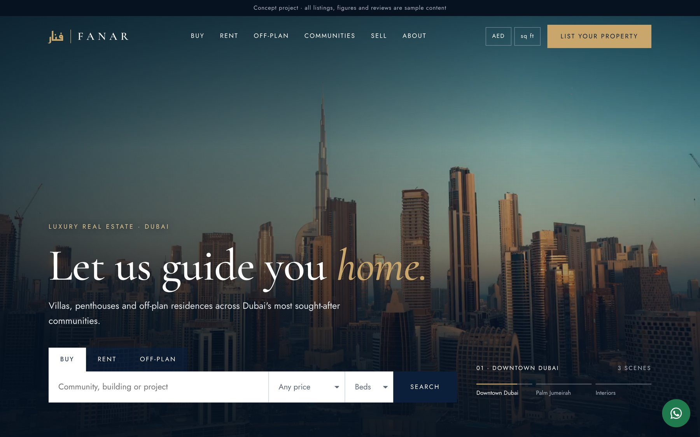
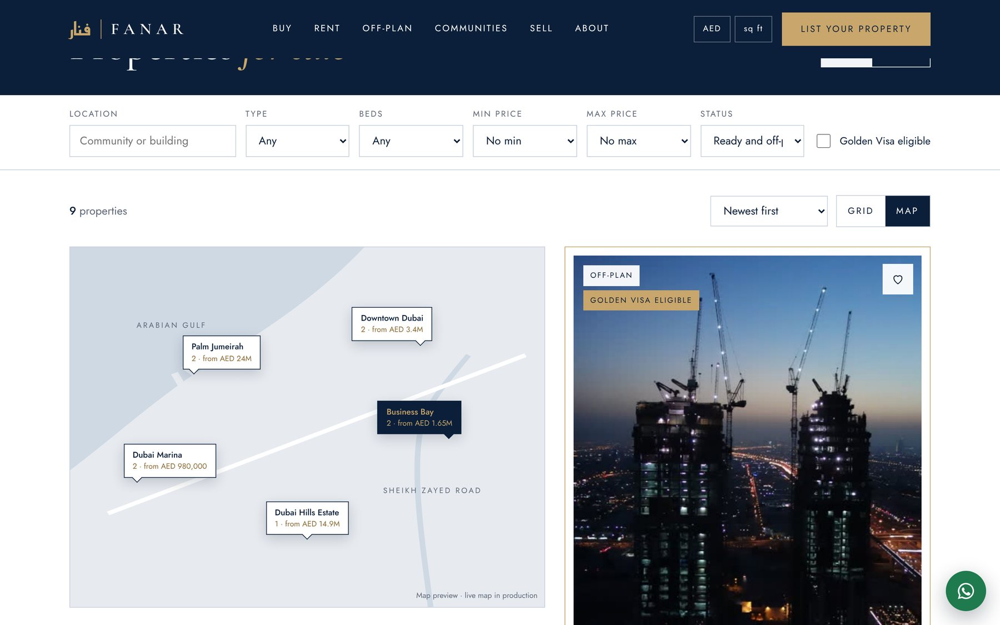
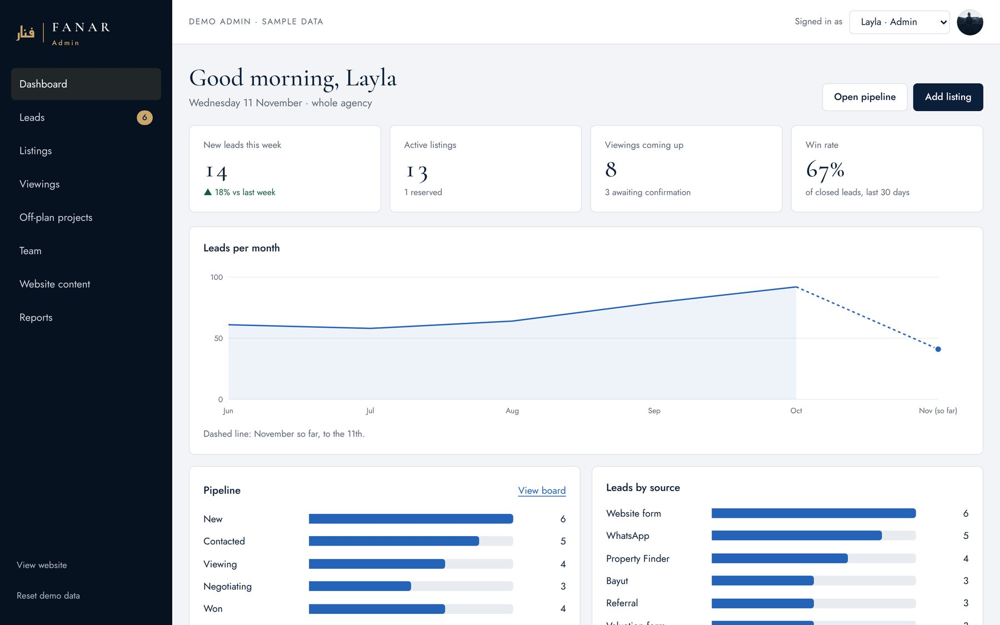

# Fanar Estates

**Luxury real estate website, bilingual brand and admin panel with CRM** · designed and built by **Arooj Fatima**





Fanar means lighthouse in Arabic. I named the agency, designed its bilingual identity and built a 39-page website: video hero, property search with a map, mortgage calculator, off-plan projects, community guides and agent pages, plus an admin panel with a CRM for leads, listings and viewings.

## Tech
- React 19
- TypeScript
- esbuild (static pages, one script per view)
- Brand identity and UI design

## Notes
Self-initiated concept project with sample data, built to the standard of client work.

---

## Project details
Concept project: a luxury real estate agency in Dubai. Designed and built by Arooj Fatima.

## What is here

| Folder | Contents |
|---|---|
| `src/views/` | Full pages (Home, and later Buy, Property, Off-plan…). Each becomes a Next.js `app/<route>/page.tsx`. |
| `src/components/` | Header, footer, hero slideshow, search bar, property card, valuation form… |
| `src/admin/` | Admin panel: dashboard, leads CRM (board and list), listings, viewings calendar, off-plan projects, team and roles, website content, reports. Open `dist/admin.html`. |
| `src/lib/` | Types, sample data, site settings, currency / area preferences |
| `src/styles/globals.css` | Brand tokens and all styles |
| `public/media/` | Hero videos and photos (credits in `public/media/CREDITS.txt`) |
| `preview/build.mjs` | Builds a static preview into `dist/` (open `dist/index.html`) |

## Brand

- Colours: Fanar Navy `#0B1F3A`, Night `#06121F`, Brass `#B08D57` (text on light `#8C6A35`), Lantern `#C9A66B`, Pearl `#F2F4F7`, Mist `#C9D1DC`, Stone `#5E6878`
- Fonts: Cormorant Garamond (headlines), Jost (text), Reem Kufi (Arabic)
- Logo: bilingual wordmark فنار | FANAR

## Moving into Next.js

1. `npx create-next-app@latest fanar --typescript --app --no-tailwind`
2. Copy `src/components`, `src/lib`, `src/styles` and `public/media` into the new project.
3. In `app/layout.tsx`, import `globals.css` and load the three fonts with `next/font/google`.
4. Each view becomes a page, e.g. `app/page.tsx`:
   ```tsx
   import Home from '@/views/Home';
   export default Home;
   ```
5. Routes already match: `/buy`, `/rent`, `/off-plan`, `/property/[slug]`, `/communities/[slug]`, `/sell`, `/team`, `/insights`, `/contact`.
6. Replace `src/lib/data.ts` with calls to the Laravel API (same shapes as `src/lib/types.ts`).

## Laravel API (next phase)

Endpoints the front end expects: `GET /api/properties`, `GET /api/properties/{slug}`, `GET /api/projects`,
`GET /api/communities`, `GET /api/agents`, `GET /api/articles`, `POST /api/leads` (valuation, enquiry, viewing).

## Admin panel

- Roles: **Admin** (everything), **Manager** (all leads and listings, no role changes), **Adviser** (only their own leads, listings and viewings). Switch persona in the top bar of the demo.
- Demo changes are kept in the browser; "Reset demo data" restores the sample data.
- API endpoints it expects: `GET/POST/PATCH /api/admin/listings`, `/api/admin/leads` (stage, assign, notes), `/api/admin/viewings`, `/api/admin/projects`, `/api/admin/team`, `/api/admin/content`, `GET /api/admin/reports`.

## Before going live

Replace placeholder contact details and RERA number in `src/lib/site.ts`, real listings with real DLD permit numbers,
and remove the concept-project ribbon in `src/components/SiteShell.tsx`.
